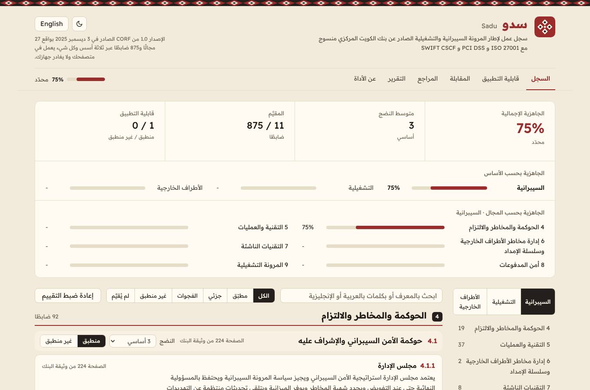
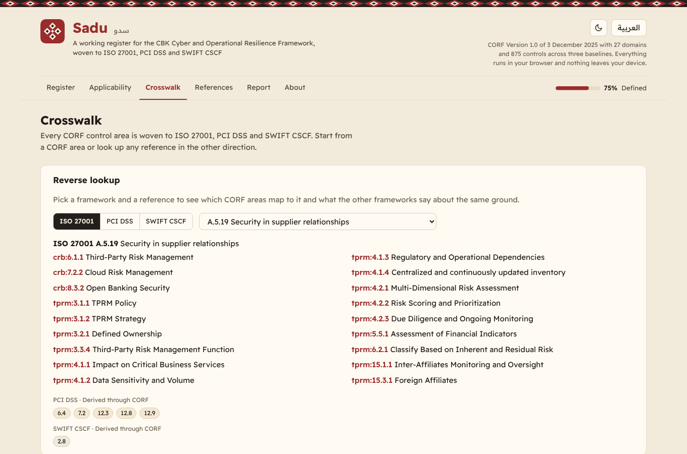
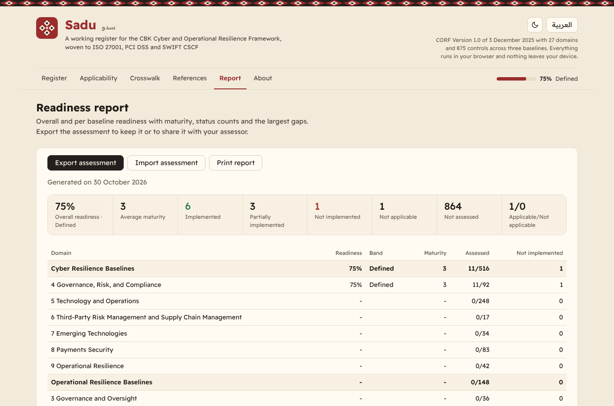

# Sadu | سدو

**A working register for the Central Bank of Kuwait Cyber and Operational Resilience Framework (CORF v1.0), woven to ISO 27001, PCI DSS v4.0.1 and SWIFT CSCF v2026. Arabic and English, with an MCP server for AI agents.**

**سجل عمل لإطار المرونة السيبرانية والتشغيلية الصادر عن بنك الكويت المركزي منسوج مع ISO 27001 و PCI DSS و SWIFT CSCF بالعربية والإنجليزية ومعه خادم MCP لمساعدي الذكاء الاصطناعي.**

Live: **https://sadu.3li.info**



## What it is

The Central Bank of Kuwait issued the Cyber and Operational Resilience Framework on 3 December 2025. It replaces the 2020 Cybersecurity Framework and sets three baselines for every regulated entity:

| Baseline | Domains | Sub-domains | Control areas | Controls |
|---|---|---|---|---|
| Cyber Resilience Baselines | 6 | 33 | 86 | 516 |
| Operational Resilience Baselines | 8 | 17 | 35 | 148 |
| Third-Party Risk Management Baselines | 13 | 43 | 78 | 211 |
| **Total** | **27** | **93** | **199** | **875** |

Sadu turns the framework into a register you can actually work in:

- **Every control gets a status** (implemented, partially implemented, not implemented, not applicable) and a note.
- **Every sub-domain gets a maturity level** on the five level scale CBK assesses against: Initial, Ad hoc, Baseline, Advanced, Innovative.
- **A statement of applicability** marks each sub-domain applicable or not, with a justification for exclusions, the way CBK asks entities to submit before assessment. Excluded sub-domains drop out of the readiness score.
- **Readiness rolls up** from control area to sub-domain to domain to baseline and overall, with a band label and the largest gaps.
- **A crosswalk** weaves every one of the 199 control areas to ISO/IEC 27001:2022 Annex A, PCI DSS v4.0.1 requirement groups and SWIFT CSCF v2026 controls. Start from CORF or look any reference up in reverse; pairwise views between ISO, PCI and SWIFT are derived through the CORF hub.
- **Export and import** the assessment as JSON, print the report, and score the same file with the MCP server.

Everything runs in the browser. Nothing is sent anywhere.

## The name

Sadu is the Kuwaiti weaving of the Bedouin loom: geometric bands of red, black and white worked from warp and weft, recognised by UNESCO as intangible heritage. A crosswalk is the same craft. CORF is the warp and the international standards are the weft, woven into one cloth you can read at a glance.

## The data

- **Structure** (baselines, domains, sub-domains, control areas, control ids and page numbers) follows the official CBK document. The document's own summary states 200 control areas and 876 controls while its body enumerates 199 and 875; the register follows the body and says so.
- **Summaries** of every control area, the Arabic text and the **crosswalk** are this project's own words and analysis. They are not the official text and not an official mapping by CBK, PCI SSC, Swift or ISO. The official wording is one click away at the page number shown on every area.
- **SWIFT CSCF v2026** is modelled as published: 32 controls, 26 mandatory and 6 advisory (2.5A, 2.11A, 5.3A, 6.5A, 7.3A, 7.4A), with 2.4 Back Office Data Flow Security mandatory from this version. Status can vary by architecture type.
- **PCI DSS v4.0.1** is modelled as 12 principal requirements and 63 requirement groups. **ISO/IEC 27001:2022** as 4 themes and 93 Annex A controls.

All Arabic follows a house style: one period at the end of a sentence, clauses joined with connectives rather than commas, natural rather than literal, and every number preserved between the two languages. The test suite enforces it.

## The MCP server

Sadu ships a read-only MCP server (stdio, JSON-RPC 2.0, no dependencies) so an AI assistant can read the register, search it, follow the crosswalk in any direction and score a saved assessment.

Run it straight from GitHub:

```json
{
  "mcpServers": {
    "sadu": {
      "command": "npx",
      "args": ["-y", "github:SiteQ8/Sadu"]
    }
  }
}
```

Or from a clone: `node mcp/server.mjs`

| Tool | What it returns |
|---|---|
| `corf_overview` | Framework summary, counts, crosswalk targets and the official source |
| `corf_list_baselines` | The three baselines with counts |
| `corf_list_domains` | The 27 domains, optionally one baseline |
| `corf_list_subdomains` | The 93 sub-domains with pages and counts, by baseline or domain |
| `corf_list_areas` | Control areas with summaries, by baseline, domain or sub-domain, paged |
| `corf_get_area` | One area: summary, control ids and pages, crosswalk references |
| `corf_search` | Search areas in English or Arabic, paged |
| `corf_crosswalk` | ISO, PCI and SWIFT references for one CORF area |
| `corf_reverse_crosswalk` | From an ISO, PCI or SWIFT reference to the CORF areas, plus what the other two frameworks say (derived) |
| `corf_list_framework` | The full ISO, PCI or SWIFT list with mandatory status and mapped area counts |
| `corf_readiness_report` | Score an assessment exported from the site: readiness, maturity, applicability, gaps |
| `corf_sources` | Sources and the provenance note |

Every tool takes `lang` (`en` or `ar`) and `response_format` (`markdown` or `json`) and returns both text and `structuredContent`. Try it without a client:

```
node mcp/server.mjs --selftest
```

## Screenshots

| Register (Arabic) | Crosswalk (English) | Report |
|---|---|---|
|  |  |  |

## Design

The register is an Operate surface: the visitor is there to finish an assessment, so the page reads as a clean ledger first and as Sadu weaving second. The world of the loom lends exactly four things: one typeface (Readex Pro), the palette of the yarn (undyed wool sand, madder red on the data and on one control, black goat hair as the emphasis fill, a little ochre), the density of a ledger, and one signature move, the woven diamond band at the head of the page and on the crown of the notice. Everything else is a standard control. The tokens, scales and rules are written down in [DESIGN.md](DESIGN.md); the test suite holds the stylesheet to them (named transitions only, no gradients, three radii, hover states gated to pointers that can hover, reduced motion honoured).

## Development

```
npm run build       # data/src -> docs/data/bundle.json with cross-checks
npm test            # data, engine, MCP and site tests
npm run preflight   # build, guards, selftest and tests in one go
```

Plain HTML, CSS and JavaScript. No build step for the site beyond the data bundle, no framework, no tracking, a strict Content Security Policy and the Readex Pro typeface bundled locally.

## Sources

- Central Bank of Kuwait, Cyber and Operational Resilience Framework v1.0: https://www.cbk.gov.kw/en/images/corf-170113_v10_tcm10-170113.pdf
- Central Bank of Kuwait: https://www.cbk.gov.kw/
- ISO/IEC 27001:2022: https://www.iso.org/standard/27001
- PCI Security Standards Council document library: https://www.pcisecuritystandards.org/document_library/
- Swift Customer Security Programme: https://www.swift.com/myswift/customer-security-programme-csp

Sadu is an independent open source tool for learning and self assessment. It is not affiliated with or endorsed by the Central Bank of Kuwait, PCI SSC, Swift or ISO, and it is not a substitute for the official documents or for an independent assessment.

## License

MIT. See [LICENSE](LICENSE) and [NOTICE.md](NOTICE.md).

Built by [Ali AlEnezi](https://3li.info) in Kuwait.
